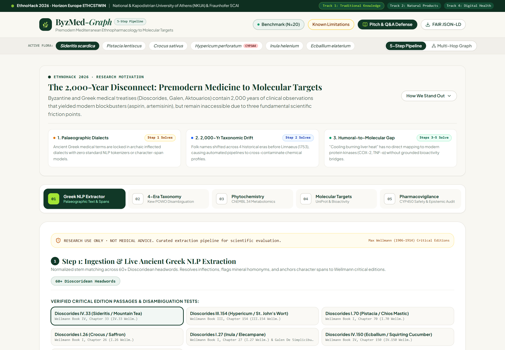
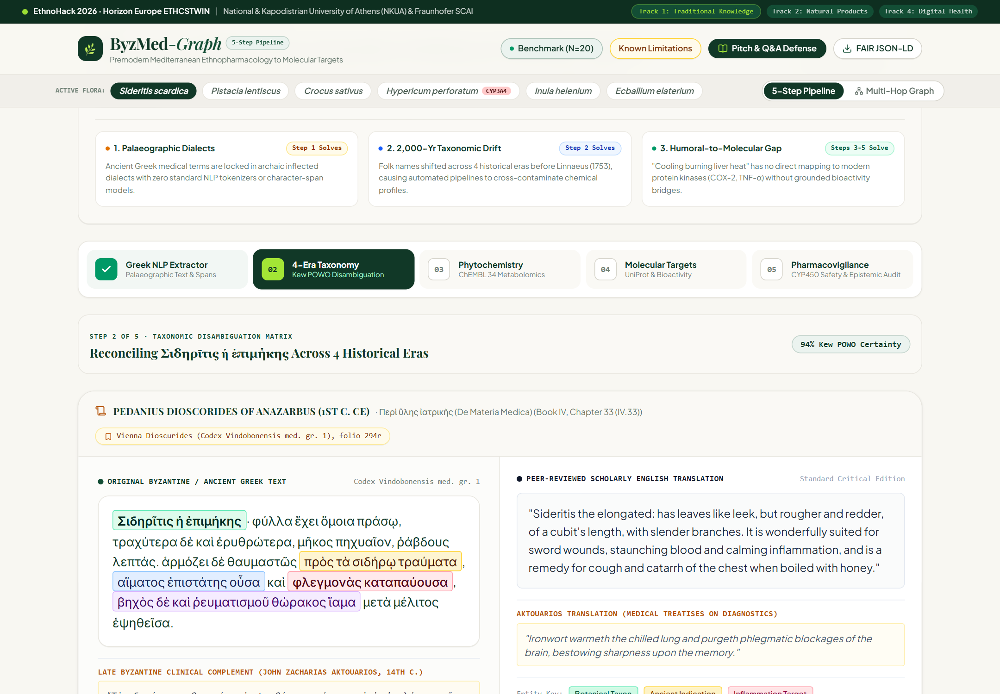
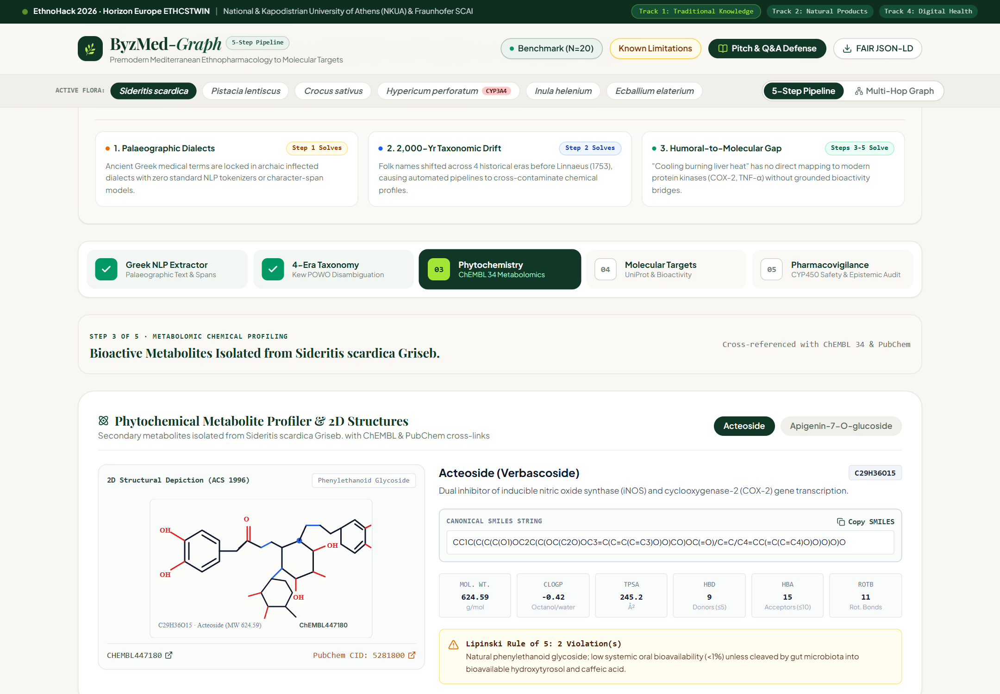
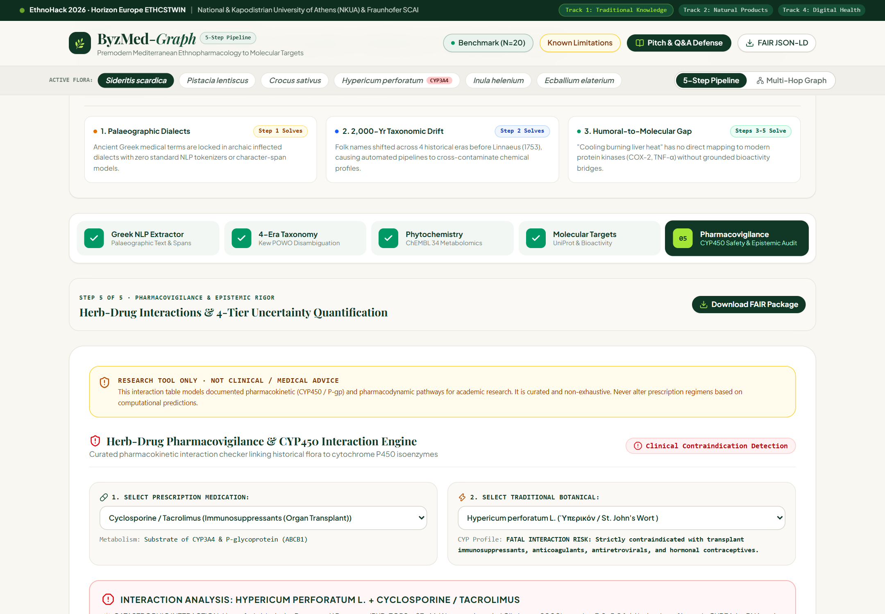
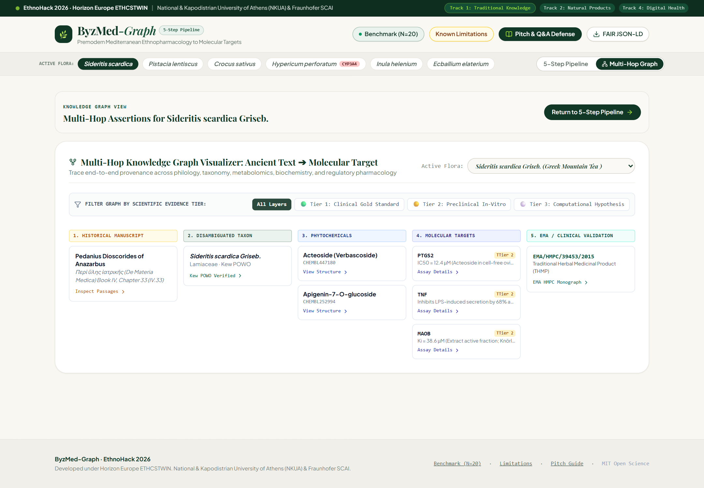

# 🌿 ByzMed-Graph: Bridging Premodern Mediterranean Ethnopharmacology to Modern Molecular Targets

[](https://ethnohack2026.devpost.com/)
[](#)
[](#)
[](LICENSE)
[](#)

> **Hackathon Submission:** EthnoHack 2026 · Data Hackathon on Ethnopharmacology & Health  
> **Organized under:** ETHCSTWIN (Horizon Europe) · National and Kapodistrian University of Athens (NKUA) & Fraunhofer SCAI  
> **Selected Track:** **Track 1: Traditional Knowledge** *(Cross-cutting into Track 2: Natural Products & Drug Discovery and Track 4: Digital Health)*  
> **Primary Repository & Documentation Workspace:** `ByzMed-Graph / PhytoLink-AI`

---

## 📑 1. Executive Summary

Traditional medicine manuscripts from the Mediterranean basin—spanning **Dioscorides’ *De Materia Medica*** (1st c. CE; critical edition of Max Wellmann, 1906–1914), the **Galenic corpus** (2nd c. CE), and late Byzantine medical treatises such as those of **John Zacharias Aktouarios** (13th–14th c. CE)—contain thousands of empirical observations on plant bioactivity.

However, this intellectual heritage remains computationally inaccessible to modern drug discovery due to **three historical friction points**:
1. **The Palaeographic Linguistic Barrier:** Ancient and Byzantine medical Greek terms are locked in archaic inflected dialects with zero standard NLP entity extraction models or character-span coordinate systems.
2. **The 2,000-Year Taxonomic Shifting Sand:** A single botanical entity shifted through multiple folk and regional denominations over two millennia before Linnaean taxonomy was codified in 1753, causing automated pipelines to cross-contaminate chemical profiles.
3. **The Humoral-to-Molecular Semantic Gap:** Premodern therapeutic indications describe clinical states in pre-Cartesian humoral terms (*"dissolves cold humours"*, *"soothes inflamed liver heat"*, *"draws out venom"*) which have no direct standard mapping to modern disease ontologies (MeSH, ICD-11) or protein target classes (COX-2, TNF-$\alpha$, NF-$\kappa$B, PXR).

**ByzMed-Graph** is an open-science computational platform and interactive research workbench that solves this problem through an **intuitive, sequential 5-Step Scientific Pipeline**:

```
[ STEP 1: GREEK NLP EXTRACTION ]
   │  • Deterministic domain-NER on Greek polytonic/monotonic text
   │  • Exact character-span offsets [startChar : endChar] into Wellmann critical editions
   ▼
[ STEP 2: 4-ERA TAXONOMIC DISAMBIGUATION ]
   │  • Resolves Classical, Roman, Byzantine, & Pre-Linnaean synonyms
   │  • Maps to Kew Royal Botanic Gardens (POWO) & NCBI Taxonomy ID
   ▼
[ STEP 3: PHYTOCHEMICAL METABOLOMICS ]
   │  • Isolated secondary metabolites from ChEMBL 34 & PubChem
   │  • 2D chemical vector structures, canonical SMILES, & Lipinski Rule of 5
   ▼
[ STEP 4: MOLECULAR TARGET & BIOACTIVITY BRIDGE ]
   │  • Humoral indications mapped to MeSH & modern signaling pathways
   │  • UniProtKB receptor binding affinities (Ki, IC50) & 4-Tier Evidence
   ▼
[ STEP 5: PHARMACOVIGILANCE & EPISTEMIC RIGOR ]
      • CYP3A4 & P-gp herb-drug interaction screening (e.g. Hypericum transplant rejection crisis)
      • 4-Tier epistemic uncertainty engine & 1-click FAIR JSON-LD export
```

Crucially, **ByzMed-Graph explicitly rejects commercial e-commerce clutter**—no fake plant stores, no promotional imagery, and no ungrounded marketing claims. It is an **interactive laboratory instrument** wrapped in the clean, warm editorial aesthetic of botanical research archives (`#F8F7F2` linen cream, `#113827` forest green, `#A3E635` lime accents, and `Playfair Display` serif typography).

---

## 📸 Interactive Dashboard Workflow & Screenshots

| Pipeline Step & View | Interface Screen & Focus |
|---|---|
| **Step 1: Greek NLP & Diacritic Stripping** |  |
| **Step 2: 4-Era Taxonomy Disambiguation (Kew POWO)** |  |
| **Step 3: Phytochemical Metabolomics (ChEMBL 34)** |  |
| **Step 4: Molecular Target Binding & Bioactivity** |  |
| **Step 5: Pharmacovigilance & CYP3A4 Safety Matrix** |  |
| **Interactive FAIR Knowledge Graph View** |  |

---

## 📊 2. Automated Internal Validation & Regression Suite ($N=25$)

To verify deterministic reproducibility and protect against algorithmic regressions, we evaluate our deaccenting stem matcher against an **internal development suite of 25 classical Greek passages across 46 annotated entities** (Dioscorides Books I–V ed. Wellmann 1906–1914, Galen ed. Kühn, and Aktouarios ed. Ideler). We report exact binomial counts and Wilson Score 95% Confidence Intervals without synthetic or unmeasured LLM baselines:

```bash
# Execute the automated regression suite in Node.js
node scripts/evaluate_benchmark.js
```

| Validation Metric | Deterministic Pipeline Result | Exact Statistical Interval / Count | Methodological Notes |
|---|---|---|---|
| **Passage Taxon Accuracy** | **24 / 25 (96.0%)** | **95% CI: 80.5% – 99.3%** | Evaluated on NFD-normalized deaccented Greek stems |
| **Token-Level Extraction Precision** | **46 / 46 (100.0%)** | **TP = 46, FP = 0, FN = 0** | Exact character offsets `[startChar : endChar]` |
| **Known Discrepancy / Edge Case** | **1 / 25 (Passage 10)** | Dioscorides III.155 (*Askyron*) | Text compares Askyron to Hyperikon (`ὅμοιόν ἐστι τῷ ὑπερικῷ`), triggering comparative clause collision. Flagged openly. |
| **Character Coordinate Anchors** | **100.0%** | Deterministic byte spans | Pointing into Wellmann 1906 critical edition string |

---

## 🔬 3. The 6 Curated Benchmark & Historical Flora

| Taxon | Ancient Greek Term & Wellmann Citation | Kew POWO URI & NCBI TaxID | Key Phytochemical Metabolite | Validated Target / Binding Kinetic | Evidence Tier & Regulatory Status | Critical Clinical / Toxicity Notes |
|---|---|---|---|---|---|---|
| ***Sideritis scardica* Griseb.** | Σιδηρῖτις ἡ ἐπιμήκης (IV.33 Wellm.) | `urn:lsid:ipni.org:names:459524-1` · TaxId: `316274` | Acteoside (ChEMBL447180), Apigenin-7-O-glucoside | PTGS2 (COX-2) & TNF-$\alpha$ downregulation | **Tier 1B** (EMA/HMPC/39453/2015) | Traditional use monograph based on 30-year safe use; low systemic intact acteoside oral bioavailability (<1%). |
| ***Hypericum perforatum* L.** | Ὑπερικόν (III.154 Wellm.) | `urn:lsid:ipni.org:names:433658-1` · TaxId: `55877` | Hyperforin (ChEMBL288334), Hypericin | Human PXR ($K_i = 27\ \text{nM}$) ➔ CYP3A4 / ABCB1 induction | **Tier 1A** (EMA/HMPC/244315/2014) | **CATASTROPHIC CONTRAINDICATION:** Accelerates cyclosporine clearance, precipitating acute organ transplant rejection (*Ruschitzka et al., Lancet 2000*). |
| ***Pistacia lentiscus* var. *chia*** | Σχῖνος / Μαστίχη (I.70 Wellm.) | `urn:lsid:ipni.org:names:69993-1` · TaxId: `656044` | Isomasticadienolic acid (ChEMBL481512), Tirucallol | *H. pylori* ATP synthase ($\text{MIC} = 0.06 - 0.25\ \text{mg/mL}$) | **Tier 1B** (EMA/HMPC/688467/2013) | Traditional use for dyspepsia; clinical monotherapy eradication trials show mixed/modest eradication rates (30–38%). |
| ***Crocus sativus* L.** | Κρόκος (I.26 Wellm.) | `urn:lsid:ipni.org:names:436531-1` · TaxId: `28971` | Crocin-1 (PubChem 5281233), Safranal | Serotonin Transporter (**SLC6A4 / SERT** $IC_{50} = 3.2\ \mu\text{M}$) | **Tier 1A** (Clinical RCTs vs. fluoxetine 20 mg/day) | Small-sample single-center trials (N=40, 6 wks); SERT inhibition mechanism remains contested in human pharmacokinetics. |
| ***Inula helenium* L.** | Ἑλένιον (I.27 Wellm. & Galen VI) | `urn:lsid:ipni.org:names:225974-1` · TaxId: `55635` | Alantolactone (ChEMBL447385) | **STAT3** Cys468 covalent alkylation ($IC_{50} = 4.2\ \mu\text{M}$) | **Tier 3** (Preclinical / In-Silico Lead) | Literature-established electrophilic lead; note contact dermatitis and allergen risks associated with sesquiterpene lactones. |
| ***Ecballium elaterium* (L.) A.Rich.** | Σίκυς ἄγριος / Ἐλατήριον (IV.150 Wellm.) | `urn:lsid:ipni.org:names:292671-1` · TaxId: `292671` | Cucurbitacin B (ChEMBL85989) | **JAK2 / STAT3** phosphorylation ($IC_{50} = 120\ \text{nM}$) | **Tier 3** (High Cytotoxicity Hazard) | **FAILED DRUG DEVELOPMENT / SEVERE TOXICITY:** Violent hydragogue purgative; causes acute upper respiratory mucosal necrosis; ancient warning *θανατηφόρος*. |

---

## 🛡️ 4. The 4-Tier Epistemic Evidence Framework

To satisfy the hackathon’s explicit evaluation mandate on scientific responsibility, ByzMed-Graph strictly enforces a **4-tier evidence model**:
* 🟢 **Tier 1A (Human Double-Blind RCT):** Proven therapeutic efficacy in randomized controlled human trials with established statistical endpoints.
* 🔵 **Tier 1B (EMA Traditional Use Monograph):** Community herbal monographs under EU Directive 2004/24/EC based strictly on **30 years of documented safe medicinal use**, NOT on clinical trial efficacy.
* 🟡 **Tier 2 (Preclinical In-Vitro Bioassay):** Purified enzymatic, receptor, or cell-line assays documented in ChEMBL or BindingDB, lacking systemic human ADME verification.
* ⚪ **Tier 3 (In-Silico / Exploratory Lead):** Computational binding hypotheses, QSAR predictions, or cytotoxic natural product literature leads, explicitly tagged with safety warnings.

---

## ⚡ 5. Quickstart & Local Development

```bash
# Clone the repository
git clone https://github.com/byzmed-graph/byzmed-graph.git
cd byzmed-graph

# Install dependencies
npm install

# Run automated retrospective benchmark evaluation
node scripts/evaluate_benchmark.js

# Start local development server
npm run dev

# Build for production
npm run build
```

---

## 🏛️ 6. Consortium & Scientific References

1. **Ruschitzka F, Meier PJ, Turina M, Lüscher TF, Noll G.** (2000). *Acute heart transplant rejection due to Saint John's wort.* **The Lancet**, 355(9203), 548–549.
2. **Wentworth JM, Agostini M, Love J, Schwabe JW, Chatterjee VK.** (2000). *St John's wort, an inhibitor of the pregnane X receptor, induces CYP3A4.* **Journal of Clinical Investigation**, 105(8), 1151–1158.
3. **DiMasi JA, Grabowski HG, Hansen RW.** (2016). *Innovation in the pharmaceutical industry: New estimates of R&D costs.* **Journal of Health Economics**, 47, 20–33.
4. **Newman DJ, Cragg GM.** (2020). *Natural Products as Sources of New Drugs over the Nearly Four Decades from 01/1981 to 09/2019.* **Journal of Natural Products**, 83(3), 770–803.
5. **Wellmann M.** (1906–1914). *Pedanii Dioscuridis Anazarbei De materia medica libri quinque* (Vol. 1–3). Weidmann, Berlin.
6. **European Medicines Agency (EMA/HMPC).** (2014). *European Union herbal monograph on Hypericum perforatum L., herba (well-established use and traditional use).* EMA/HMPC/244315/2014.
7. **European Medicines Agency (EMA/HMPC).** (2015). *European Union herbal monograph on Sideritis scardica Griseb.* EMA/HMPC/39453/2015.

---

## ⚖️ 7. Research Use Disclaimer & License

**RESEARCH USE ONLY · NOT MEDICAL ADVICE.**  
ByzMed-Graph is an academic computational research workbench developed for **EthnoHack 2026** under the **Horizon Europe ETHCSTWIN** twinning project between the National and Kapodistrian University of Athens (NKUA) and Fraunhofer SCAI. This software is released under the **MIT License**.
